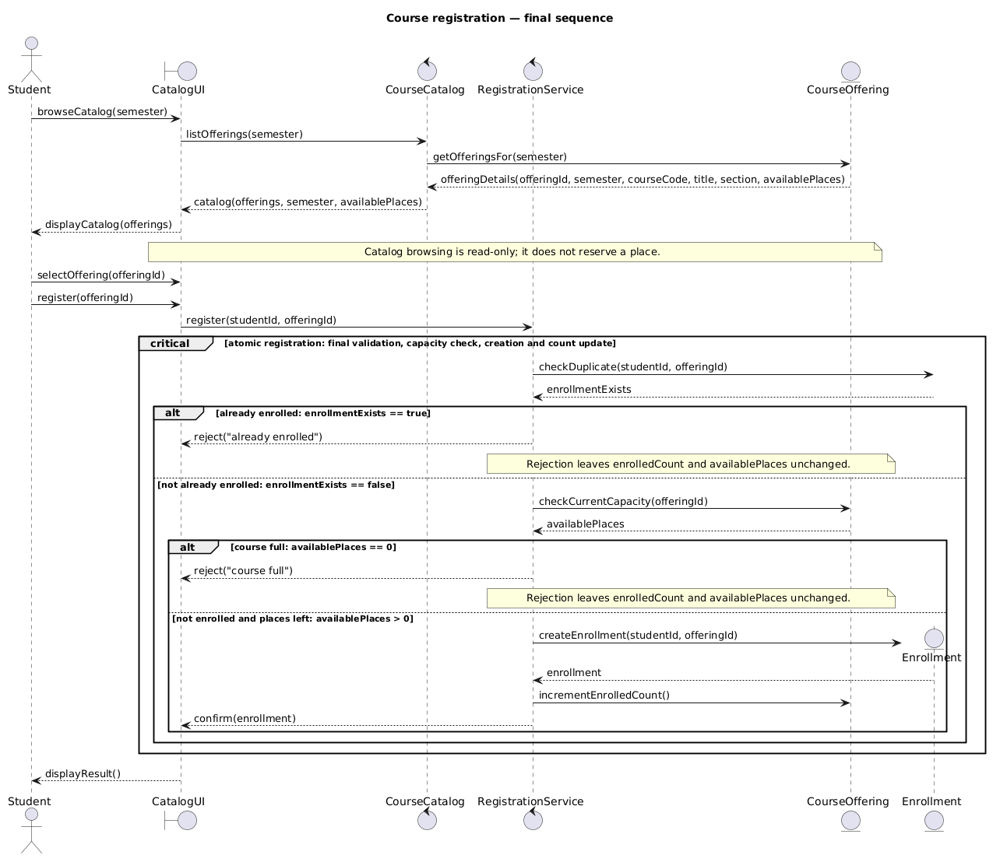
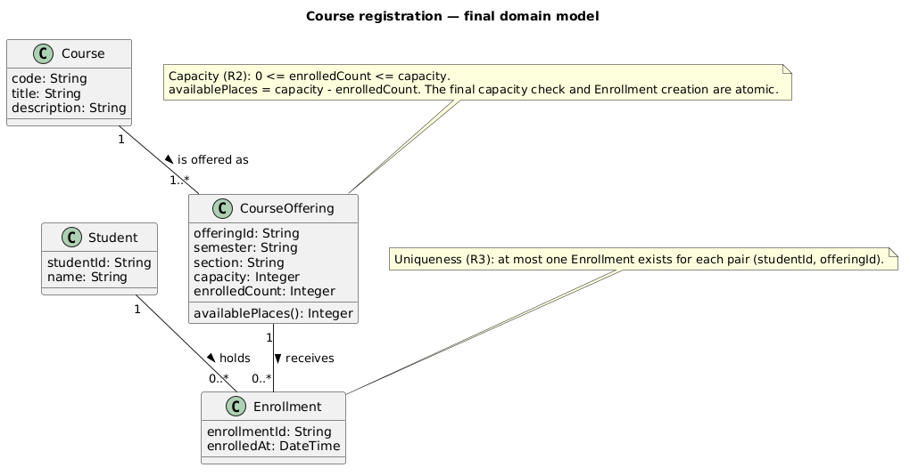
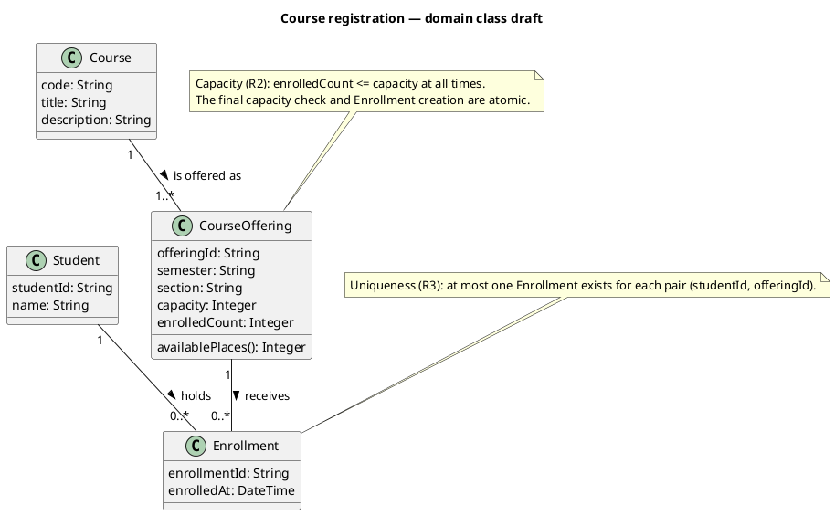
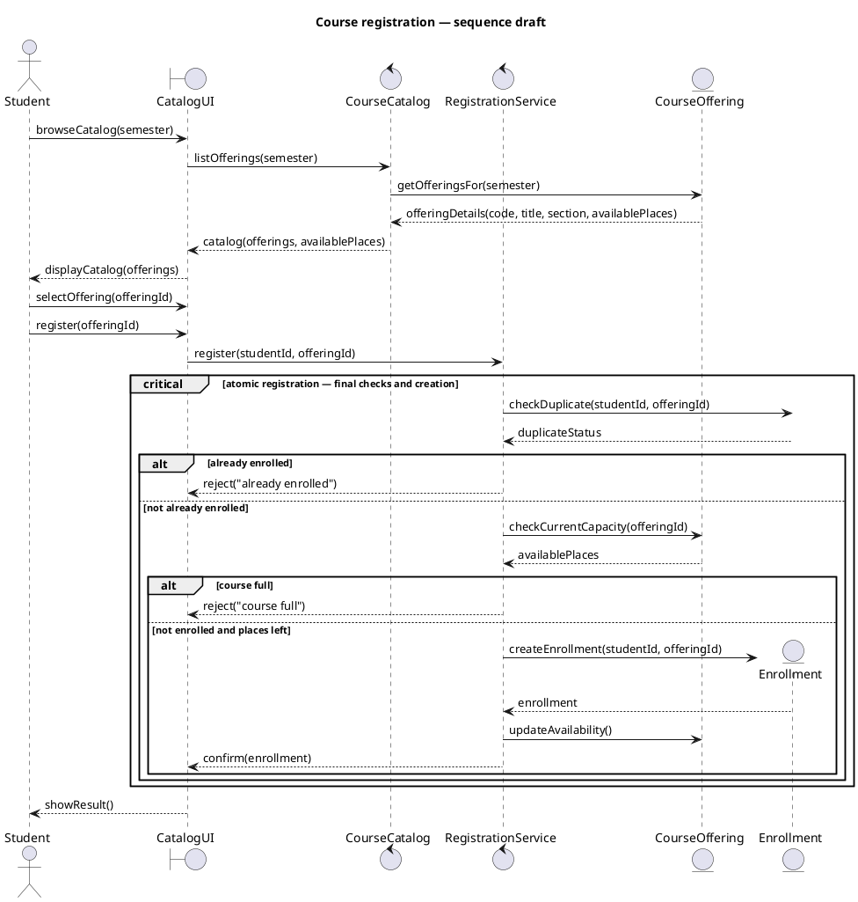
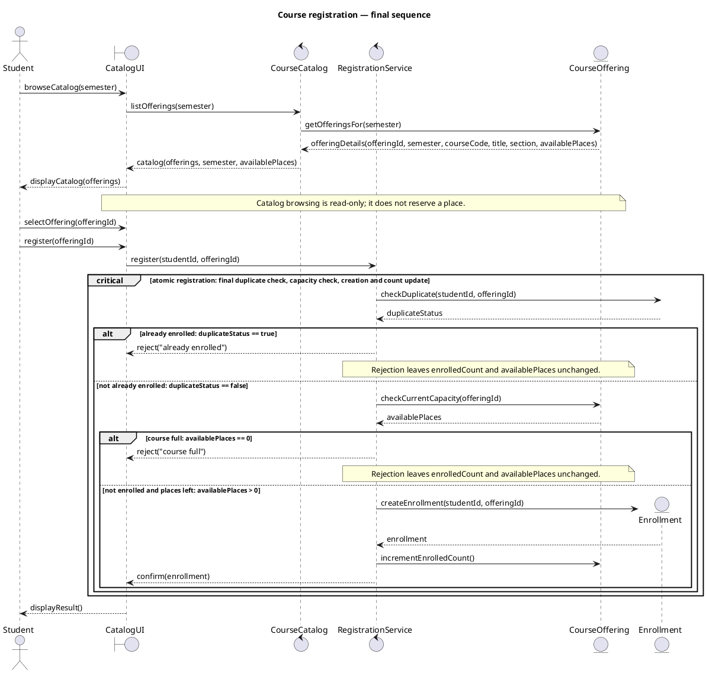
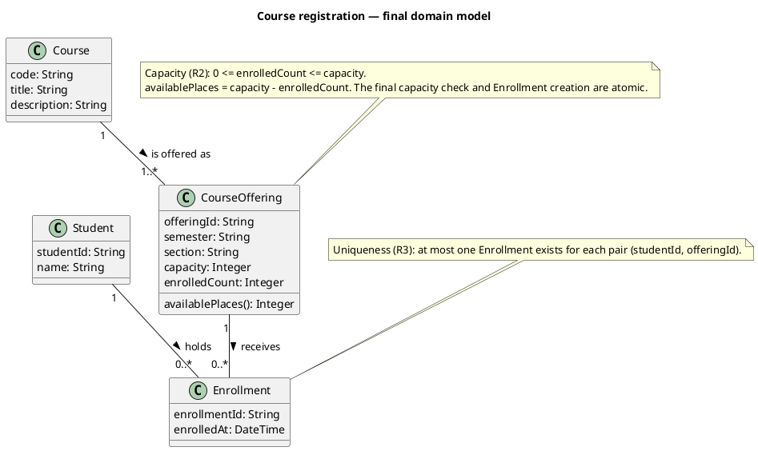
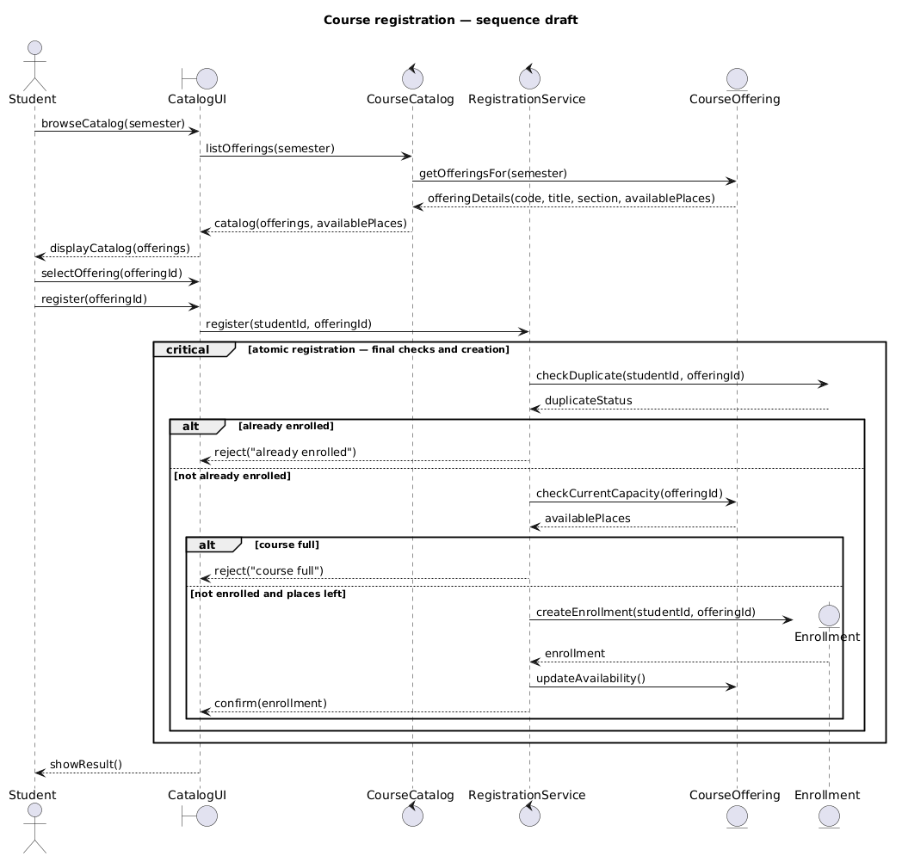
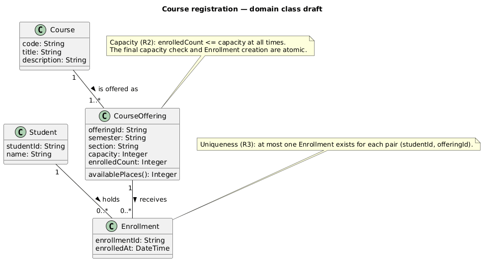

# SIS #02 — AI-Assisted UML Modeling: University Course Registration

<!--
  This is the only file you write your report in. README.md tells you what goes where.

  Rules the checker relies on:
  - Do not delete, rename or renumber the ## headings, the ### headings, or the **Label:** words.
  - Replace every "(write here)" and "(paste here)". None may be left when you submit.
  - Comments like this one are ignored by the checker and the word counter. Delete them or leave them.
-->

## 1. Scope and assumptions

<!-- Your FINAL scope statement and assumptions, after reviewing Prompt A's output. Say here
     what is out of scope (payments, prerequisites, timetable clashes, waiting lists,
     cancellation) — section 2 must not mention them. Section 10 keeps your first version. -->

**Scope:** The system supports browsing electronic course offerings for one semester and registering a signed-in student in a specific offering. It displays course details and available places, rechecks capacity and duplicate enrollment during registration, creates an enrollment on success, and explains rejection outcomes. Payments, prerequisites, timetable clashes, waiting lists, and cancellation are out of scope.

**Assumptions:**

1. The student is already authenticated, the selected course offering exists, and its capacity is a positive whole number.
2. The final availability checks, duplicate validation, and enrollment creation are treated as one atomic operation to prevent race conditions when multiple students attempt to claim the last remaining seat.

## 2. User stories and acceptance criteria

<!-- Your APPROVED requirements: Prompt A's draft after your review. Keep the IDs, the three
     story headings and the bullet shape. Every criterion names the rule(s) it maps to,
     e.g. (R2, R4). Two criteria per story. Nothing out of scope.
     Format of a criterion, on one bullet:
     - **AC-03** (R2, R4): Given ..., When ..., Then ... -->

### US-01 — Browse offerings

**US-01:** As a student, I want to browse course offerings for a semester, so that I can compare the courses and available places before choosing one.

- **AC-01** (R1): Given the student selects a semester, When the catalog is displayed, Then each offering shows its course code, course title, offering, and available places for that semester.
- **AC-02** (R1): Given a course offering is listed in the selected semester, When the student views its catalog entry, Then the entry identifies the specific offering and its current available places without reserving a place.

### US-02 — Register for an offering

**US-02:** As a student, I want to request enrollment in a specific course offering, so that I can secure a place when capacity is available.

- **AC-03** (R2, R3, R4): Given the student is not already enrolled and the offering has available capacity, When the student requests registration, Then the system atomically rechecks current availability and duplicates, creates exactly one Enrollment linking the student and offering, updates availability, and returns a confirmation.
- **AC-04** (R2, R4): Given two students concurrently request the last available place in the same offering, When both registration requests are processed, Then at most one Enrollment is created and the offering's capacity is never exceeded.

### US-03 — Receive a clear rejection

**US-03:** As a student, I want a clear explanation when registration is rejected, so that I know why I was not enrolled.

- **AC-05** (R2, R5): Given the catalog showed an available place but the offering became full before registration, When the student requests registration, Then the system rejects the request with "course full", creates no Enrollment, and leaves the enrollment count unchanged.
- **AC-06** (R3, R5): Given the student is already enrolled in the selected offering, When the student repeats the registration request, Then the system rejects it with "already enrolled", creates no additional Enrollment, and leaves the enrollment count unchanged.

## 3. Sequence diagram

<!-- The FINAL diagram, rendered. Change .png to .svg if that is what you exported. -->



**Participants:** `Student` is the signed-in user actor; `CatalogUI` represents the user-facing boundary; `CourseCatalog` retrieves semester offerings; `RegistrationService` coordinates registration; `CourseOffering` supplies current capacity information and tracks its enrollment count; `Enrollment` is the created domain record.

**Atomic operation:** The `critical` fragment contains `checkDuplicate`, `checkCurrentCapacity`, `createEnrollment`, and `incrementEnrolledCount`, so concurrent requests cannot claim the same last place between checking and creation. The catalog messages only read and display places; the note explicitly says browsing reserves nothing.

**Where the Enrollment is created:** The `create Enrollment` directive precedes `RegistrationService -> Enrollment: createEnrollment(studentId, offeringId)` on the success branch. It creates one instance of the `Enrollment` class in section 4.

**Technical lifelines:** `CatalogUI`, `CourseCatalog`, and `RegistrationService` are boundary/control responsibilities in the interaction, not persistent domain classes. Their omission from the domain class diagram is intentional: that diagram focuses on `Student`, `Course`, `CourseOffering`, and `Enrollment`.

## 4. Class diagram

<!-- The FINAL diagram, rendered. -->



<!-- One row per association in classes.puml, read in both directions. -->

| Association | Read left to right | Read right to left |
| --- | --- | --- |
| Student — Enrollment | Each Student holds zero or more Enrollments. | Each Enrollment belongs to exactly one Student. |
| CourseOffering — Enrollment | Each CourseOffering receives zero or more Enrollments. | Each Enrollment targets exactly one CourseOffering. |
| Course — CourseOffering | Each Course has one or more CourseOfferings in this model. | Each CourseOffering describes exactly one Course. |

**How an Enrollment links a student to an offering:** Enrollment is the association entity with two required associations: one to exactly one Student and one to exactly one CourseOffering. The paired foreign-key-like identifiers in the sequence are the studentId and offeringId.

**Capacity constraint:** The note states `0 <= enrolledCount <= capacity` and `availablePlaces = capacity - enrolledCount`. A multiplicity cannot express a numerical invariant comparing the value of an attribute against the number of Enrollment instances, so it is stated as a constraint.

**Uniqueness constraint:** The note states that at most one Enrollment may exist for each `(studentId, offeringId)` pair. Multiplicity limits the number of links at an association end but cannot enforce uniqueness for each specific pair of Student and CourseOffering.

## 5. Traceability

<!-- Every rule, including the catalog fields and availability (R1). Column 1: the rule and
     the criteria that cover it, e.g. "R2 + AC-03, AC-04". Column 2: the message, guard,
     class or constraint that shows the rule in YOUR diagrams. Column 3: the T-ID that
     exercises it, or the extra check you did instead (R1 has no T case). -->

| Rule and criterion | Model evidence | Validation case |
| --- | --- | --- |
| R1 + AC-01, AC-02 | `listOfferings(semester)` returns code, title, offeringId, semester and availablePlaces; catalog note says it reserves no place. | Extra field check: verify all required fields and semester filtering; T1 also displays a non-reserving catalog. |
| R2 + AC-03, AC-04, AC-05 | Atomic `checkCurrentCapacity`; `availablePlaces == 0` full guard; `availablePlaces > 0` success guard; increment count only in success branch. | T2 (one final place), T3 (stale catalog, currently full). |
| R3 + AC-03, AC-06 | Atomic `checkDuplicate`; `duplicateStatus == true` guard and “already enrolled” rejection. | T4. |
| R4 + AC-03, AC-04 | Success path creates one Enrollment, increments enrolledCount once, then confirms; Enrollment links Student and CourseOffering. | T1, T2. |
| R5 + AC-05, AC-06 | Full and duplicate branches return their specified reason and each has a note that count and availability remain unchanged. | T3, T4. |

## 6. Walkthroughs

<!-- Walk each case through YOUR final sequence diagram, message by message. Column 2: the
     actual steps and the state change (count before → after). Column 3 starts with Pass or
     Fail, then the location: the message, guard or note where you saw it. A Fail you
     report honestly is a finding, not a penalty. -->

| Case | Observed path and state change | Judgment and evidence |
| --- | --- | --- |
| T1. Available | Starting with capacity 2 and enrolledCount 0, the Student browses the semester catalog and sees 2 available places, then selects and registers for the specific offering. Inside the critical region, the duplicate check returns false and the current capacity check returns 2; the `availablePlaces > 0` branch succeeds. The system creates one Enrollment, increments enrolledCount from 0 to 1, and then confirms registration. | Pass — `critical` registration region, `else not enrolled and places left: availablePlaces > 0`, `createEnrollment`, `incrementEnrolledCount()`, then `confirm(enrollment)`. |
| T2. Last place | Starting with capacity 2 and enrolledCount 1, the Student browses the catalog and sees 1 available place, then selects and registers for that offering. In the critical region, the duplicate check returns false and the current capacity check returns availablePlaces 1, so the `availablePlaces > 0` branch succeeds. One Enrollment is created and enrolledCount changes from 1 to 2; availablePlaces becomes 0, and registration is confirmed. | Pass — the current-capacity response and `availablePlaces > 0` guard route the last-place case to `createEnrollment`; `incrementEnrolledCount()` precedes `confirm(enrollment)`. |
| T3. Full | The Student previously saw a place in the catalog, but the offering is full when registration is processed (capacity 2, enrolledCount 2). The Student sends the registration request; inside the critical region the duplicate check returns false and the fresh capacity check returns availablePlaces 0. The `availablePlaces == 0` branch rejects with “course full”; no Enrollment is created and enrolledCount stays 2. The UI displays the rejection result. | Pass — the current `checkCurrentCapacity` response selects `alt course full: availablePlaces == 0`; the branch returns `reject("course full")` and notes enrolledCount and availablePlaces unchanged. |
| T4. Duplicate | Starting with capacity 2 and enrolledCount 1, the already-enrolled Student sends another registration request for the same offering. In the critical region, `checkDuplicate` finds the existing Enrollment, so the `enrollmentExists == true` branch rejects the request as “already enrolled.” No new Enrollment is created and enrolledCount remains 1; the UI displays the rejection result. The capacity check is not reached because duplicate detection is evaluated first. | Pass — `alt already enrolled: enrollmentExists == true` returns `reject("already enrolled")` and states enrolledCount and availablePlaces are unchanged. |

## 7. Review decisions

<!-- At least three substantive decisions about Prompt C's critique or your own inspection.
     Decision: accepted / rejected / modified — and what you did. Reason: why, in a full
     sentence. Rule: R1–R5. Do not invent an error to fill the table; a justified rejection
     of advice counts. -->

| AI suggestion or model element | Decision | Reason | Rule |
| --- | --- | --- | --- |
| Catalog result omitted `offeringId` and semester | accepted — added both identifiers to `offeringDetails` and the catalog response | The student must select the same specific offering that registration later targets, and semester is required to scope R1's catalog. | R1 |
| Capacity alternatives had descriptive labels but no numeric predicates | accepted — added the current `availablePlaces == 0` and `availablePlaces > 0` conditions | Explicit boundary guards show that a full offering rejects and one remaining place can still succeed without exceeding capacity. | R2 |
| Successful path did not show the count change; rejections did not state unchanged count | accepted — increment once after creation and state no count/availability change on each rejection | This makes the success state update and R5's no-side-effect rejection behavior observable in the sequence. | R4, R5 |
| Optional suggestion to replace Course–CourseOffering `1..*` with `0..*` | rejected — retained `1..*` for the modeled set of courses, each of which has at least one offering | The assignment models courses through scheduled offerings; allowing a course with no offering is not required by this scope and would weaken the chosen domain assumption. | R1 |

## 8. Modeling explanation

<!-- 200–300 words. Your main design choices; how the class diagram and the sequence diagram
     complement each other; why an activity diagram could also help explain the workflow. -->

The sequence diagram represents the registration interaction, while the class diagram captures the persistent domain concepts and their relationships. I kept the required domain model to Student, Course, CourseOffering and Enrollment. The Enrollment class is associated with exactly one student and one offering, so the record represents a student's registration in a particular scheduled section rather than in a course in the abstract. CourseOffering carries semester and capacity information; its availablePlaces operation is derived from capacity minus enrolledCount.

The sequence starts with semester-scoped catalog browsing and then sends a registration request for a specific offering. The catalog returns offeringId, semester and available places but does not reserve a seat. RegistrationService performs the final duplicate and current-capacity checks inside one critical region. The guarded branches make the full, duplicate and success outcomes distinguishable. Only the success branch creates Enrollment, increments the count once and confirms registration. Both rejection branches state that enrollment count and availability remain unchanged. I retained CatalogUI, CourseCatalog and RegistrationService as technical lifelines because they describe interaction responsibilities, not additional domain entities.

The diagrams complement each other: the class diagram defines what an enrollment connects and records; the sequence diagram shows when that record is created and how capacity and duplicate rules affect the interaction. An activity diagram could add a workflow-oriented view of the decision sequence, especially the alternative rejection paths and the success path, without replacing the structural and message-level details in these two models.

## 9. Reflection

<!-- 150–200 words. Written by you, not by the assistant: where AI helped, one decision you
     made yourself, one remaining limitation. Specific beats flattering. -->

Working on this assignment with AI assistance highlighted both the productivity benefits and the boundaries of large language models in software engineering. AI significantly accelerated the initial drafting phase by rapidly generating user stories, acceptance criteria structures, and PlantUML skeletons for both the sequence and class diagrams, which saved a considerable amount of structural boilerplate setup time. However, critical engineering judgment remained entirely my own responsibility, particularly during the model critique and revision stages. For instance, I carefully evaluated the proposed atomic operation logic, ensuring that capacity and duplicate checks strictly governed the alternative execution paths to prevent race conditions and maintain data integrity according to rules R1 through R5. I also manually verified the multiplicities and constraints in the class diagram to reflect the domain logic accurately. A primary limitation of the AI models remains their occasional lack of deep contextual consistency in complex state transitions and edge cases. Without rigorous human verification and step-by-step walkthroughs, generated diagrams can overlook subtle concurrency requirements or misalign with specific architectural rules. Ultimately, AI serves as an effective accelerator, but human oversight is indispensable for ensuring correctness.

## 10. Appendix A — Before AI

<!-- Written BEFORE you run Prompt A, committed and pushed in your first commit, and never
     edited afterwards. This is what you paste into Prompt A as "My initial assumptions". -->

**Scope:** The system automates the process of browsing electronic course catalogs, selecting course offerings, and managing student registrations for specific semesters, ensuring availability checks and preventing duplicate enrollments.

**Initial assumptions:**

1. The student is already authenticated, the selected course offering exists, and its capacity is a positive whole number.
2. The final availability checks, duplicate validation, and enrollment creation are treated as one atomic operation to prevent race conditions when multiple students attempt to claim the last remaining seat.

## 11. Appendix B — AI exchanges

<!-- Complete prompts and complete responses, as text — never screenshots. Paste each inside
     the ~~~~ block that follows its label: AI responses contain ``` PlantUML blocks, and
     ~~~~ keeps them from breaking this file. Prompts B and C: the prompt text first, then
     the material it refers to ("below", "these two") pasted under it, in the same block.
     You may add B5, B6 … after B4 if you ran more. -->

### B1 — Requirements (Prompt A)

- **Tool:** Copilot assistant in VS Code
- **Model:** not displayed
- **Date:** 2026-10-18
- **Purpose:** draft 3 user stories and 6 acceptance criteria

<!-- Model: the exact model with its version, as the tool shows it (e.g. "GPT-5 Thinking",
     "Claude Sonnet 4.5"). If the tool does not show it, write: not displayed
     Date: YYYY-MM-DD -->

**Prompt:**

~~~~text
Act as a requirements analyst. Use only this course registration scenario and rules R1–R5: A student browses an electronic course catalog, chooses a course offering and requests registration. Each offering has a limited number of places. A Course describes a subject. A CourseOffering is one scheduled section in one semester. Registration always targets a specific offering. Assume that the student is signed in, the selected offering exists, and its capacity is a positive whole number. Exclude payments, prerequisites, timetable clashes, waiting lists and cancellation. Use fictional students and courses.

R1. Catalog: Show the course code, title, offering and available places for one semester.
R2. Capacity: Recheck current availability when registering. Enrollment must never exceed the offering's capacity.
R3. Duplicates: A student may have at most one enrollment in the same offering. Reject a repeat request.
R4. Success: Create exactly one Enrollment linking the student and offering, update availability and return a confirmation.
R5. Rejection: Explain "course full" or "already enrolled". Create no enrollment and leave the enrollment count unchanged.

These rules define this assignment. A catalog view does not reserve a place. Model the final checks and enrollment creation as one atomic operation so competing requests cannot take the same last place. A note describing the atomic operation is sufficient; database implementation is outside this assignment. My initial assumptions are Scope: The system automates the process of browsing electronic course catalogs, selecting course offerings, and managing student registrations for specific semesters, ensuring availability checks and preventing duplicate enrollments. Assumptions: (1) The student is already authenticated, the selected course offering exists, and its capacity is a positive whole number. (2) The final availability checks, duplicate validation, and enrollment creation are treated as one atomic operation to prevent race conditions when multiple students attempt to claim the last remaining seat.

Draft 3 user stories and 2 Given / When / Then acceptance criteria for each. Use IDs US-01 to US-03 and AC-01 to AC-06. Map each criterion to rule IDs.
Cover normal and rejection behavior. List uncertainty separately. Do not add excluded features or invent university policies.
~~~~

**Response:**

~~~~text
### US-01 — Browse offerings

**US-01:** As a student, I want to browse course offerings for a semester, so that I can compare the courses and available places before choosing one.

- **AC-01** (R1): Given the student selects a semester, When the catalog is displayed, Then each offering shows its course code, course title, offering, and available places for that semester.
- **AC-02** (R1): Given a course offering is listed in the selected semester, When the student views its catalog entry, Then the entry identifies the specific offering and its current available places without reserving a place.

### US-02 — Register for an offering

**US-02:** As a student, I want to request enrollment in a specific course offering, so that I can secure a place when capacity is available.

- **AC-03** (R2, R3, R4): Given the student is not already enrolled and the offering has available capacity, When the student requests registration, Then the system atomically rechecks current availability and duplicates, creates exactly one Enrollment linking the student and offering, updates availability, and returns a confirmation.
- **AC-04** (R2, R4): Given two students concurrently request the last available place in the same offering, When both registration requests are processed, Then at most one Enrollment is created and the offering's capacity is never exceeded.

### US-03 — Receive a clear rejection

**US-03:** As a student, I want a clear explanation when registration is rejected, so that I know why I was not enrolled.

- **AC-05** (R2, R5): Given the catalog showed an available place but the offering became full before registration, When the student requests registration, Then the system rejects the request with "course full", creates no Enrollment, and leaves the enrollment count unchanged.
- **AC-06** (R3, R5): Given the student is already enrolled in the selected offering, When the student repeats the registration request, Then the system rejects it with "already enrolled", creates no additional Enrollment, and leaves the enrollment count unchanged.

### Uncertainty

- The scenario does not specify the exact display format for an offering beyond the required catalog fields; the criteria require those fields to be present without prescribing a layout.
- The rules do not define a persistence or database technology; the atomic operation is modeled as a constraint/operation without choosing an implementation.
~~~~

### B2 — UML drafts (Prompt B)

- **Tool:** Copilot assistant in VS Code
- **Model:** not displayed
- **Date:** 2026-10-18
- **Purpose:** draft the sequence and class diagrams

**Prompt:**

~~~~text
Using my approved scenario, R1–R5, stories and criteria below, return separate PlantUML code blocks for a sequence diagram and a domain class diagram.
Sequence: include catalog browsing and guarded success, full-course and duplicate outcomes. Model final checks and creation as one atomic operation.
Class: show domain concepts, useful attributes and multiplicities. State the capacity and uniqueness constraints. Explain assumptions and any technical lifelines.

Approved scenario and rules:
A student browses an electronic course catalog, chooses a course offering and requests registration. Each offering has a limited number of places. A Course describes a subject. A CourseOffering is one scheduled section in one semester. Registration always targets a specific offering. Assume that the student is signed in, the selected offering exists, and its capacity is a positive whole number. Exclude payments, prerequisites, timetable clashes, waiting lists and cancellation. Use fictional students and courses.
R1. Catalog: Show the course code, title, offering and available places for one semester.
R2. Capacity: Recheck current availability when registering. Enrollment must never exceed the offering's capacity.
R3. Duplicates: A student may have at most one enrollment in the same offering. Reject a repeat request.
R4. Success: Create exactly one Enrollment linking the student and offering, update availability and return a confirmation.
R5. Rejection: Explain "course full" or "already enrolled". Create no enrollment and leave the enrollment count unchanged.

Approved stories and criteria:
US-01 — Browse offerings
As a student, I want to browse course offerings for a semester, so that I can compare the courses and available places before choosing one.
AC-01 (R1): Given the student selects a semester, When the catalog is displayed, Then each offering shows its course code, course title, offering, and available places for that semester.
AC-02 (R1): Given a course offering is listed in the selected semester, When the student views its catalog entry, Then the entry identifies the specific offering and its current available places without reserving a place.
US-02 — Register for an offering
As a student, I want to request enrollment in a specific course offering, so that I can secure a place when capacity is available.
AC-03 (R2, R3, R4): Given the student is not already enrolled and the offering has available capacity, When the student requests registration, Then the system atomically rechecks current availability and duplicates, creates exactly one Enrollment linking the student and offering, updates availability, and returns a confirmation.
AC-04 (R2, R4): Given two students concurrently request the last available place in the same offering, When both registration requests are processed, Then at most one Enrollment is created and the offering's capacity is never exceeded.
US-03 — Receive a clear rejection
As a student, I want a clear explanation when registration is rejected, so that I know why I was not enrolled.
AC-05 (R2, R5): Given the catalog showed an available place but the offering became full before registration, When the student requests registration, Then the system rejects the request with "course full", creates no Enrollment, and leaves the enrollment count unchanged.
AC-06 (R3, R5): Given the student is already enrolled in the selected offering, When the student repeats the registration request, Then the system rejects it with "already enrolled", creates no additional Enrollment, and leaves the enrollment count unchanged.
~~~~

**Response:**

~~~~text
Sequence diagram:
```plantuml
@startuml
title Course registration — sequence draft

actor Student
boundary CatalogUI
control CourseCatalog
control RegistrationService
entity CourseOffering
entity Enrollment

Student -> CatalogUI: browseCatalog(semester)
CatalogUI -> CourseCatalog: listOfferings(semester)
CourseCatalog -> CourseOffering: getOfferingsFor(semester)
CourseOffering --> CourseCatalog: offeringDetails(code, title, section, availablePlaces)
CourseCatalog --> CatalogUI: catalog(offerings, availablePlaces)
CatalogUI --> Student: displayCatalog(offerings)

Student -> CatalogUI: selectOffering(offeringId)
Student -> CatalogUI: register(offeringId)
CatalogUI -> RegistrationService: register(studentId, offeringId)

critical atomic registration — final checks and creation
  RegistrationService -> Enrollment: checkDuplicate(studentId, offeringId)
  Enrollment --> RegistrationService: duplicateStatus
  alt already enrolled
    RegistrationService --> CatalogUI: reject("already enrolled")
  else not already enrolled
    RegistrationService -> CourseOffering: checkCurrentCapacity(offeringId)
    CourseOffering --> RegistrationService: availablePlaces
    alt course full
      RegistrationService --> CatalogUI: reject("course full")
    else not enrolled and places left
      RegistrationService -> Enrollment: createEnrollment(studentId, offeringId)
      create Enrollment
      Enrollment --> RegistrationService: enrollment
      RegistrationService -> CourseOffering: updateAvailability()
      RegistrationService --> CatalogUI: confirm(enrollment)
    end
  end
end
CatalogUI --> Student: showResult()
@enduml
```

Class diagram:


Assumptions: available places are calculated as capacity minus enrolledCount. Enrollment is the association entity between one Student and one CourseOffering. The uniqueness and capacity rules are constraints beyond basic association multiplicities.

The sequence diagram uses technical lifelines CatalogUI, CourseCatalog, and RegistrationService to separate user interaction, browsing, and registration responsibilities. Enrollment and CourseOffering are domain lifelines. The atomic region includes the final duplicate check, capacity check, creation, and availability update; browsing displays availability but reserves no place.
~~~~

**Rendering note:** The Prompt B response above is preserved as returned. PlantUML rejected the original sequence block because `create Enrollment` followed its creation message. To render the original draft, I moved that directive immediately before the message in `models/original/sequence.puml`; this one-line syntax correction is disclosed, so that source file is not byte-for-byte identical to the response.

### B3 — Model critique (Prompt C)

- **Tool:** Copilot assistant in VS Code, new chat
- **Model:** not displayed
- **Date:** 2026-10-18
- **Purpose:** review both models against R1–R5 and T1–T4

**Prompt:**

~~~~text
This is a fresh chat for the SIS 02 modeling assignment. Please execute Prompt C exactly as pasted below and provide a thorough critique response (150+ words). Do not edit any files. Preserve the distinctions between genuine defects and optional design choices. The PlantUML source below is what is in models/original; note that after the generated Prompt B response, the `create Enrollment` directive was moved before the creation message solely to make the sequence syntax render, and this deviation was disclosed.

Exact Prompt C:
Review these two UML models against R1–R5 and my acceptance criteria. Check message order, guards, state changes, multiplicities and naming.
Inspect the four validation cases: available places, exactly one place, full course after a stale catalog view, and duplicate registration.
For each issue, cite the affected rule and model element. Explain the impact and propose a focused correction. Separate genuine defects from optional design choices.

R1–R5:
R1 Catalog: Show the course code, title, offering and available places for one semester.
R2 Capacity: Recheck current availability when registering. Enrollment must never exceed the offering's capacity.
R3 Duplicates: A student may have at most one enrollment in the same offering. Reject a repeat request.
R4 Success: Create exactly one Enrollment linking the student and offering, update availability and return a confirmation.
R5 Rejection: Explain "course full" or "already enrolled". Create no enrollment and leave the enrollment count unchanged.

My acceptance criteria:
US-01 — Browse offerings
AC-01 (R1): Given the student selects a semester, When the catalog is displayed, Then each offering shows its course code, course title, offering, and available places for that semester.
AC-02 (R1): Given a course offering is listed in the selected semester, When the student views its catalog entry, Then the entry identifies the specific offering and its current available places without reserving a place.
US-02 — Register for an offering
AC-03 (R2, R3, R4): Given the student is not already enrolled and the offering has available capacity, When the student requests registration, Then the system atomically rechecks current availability and duplicates, creates exactly one Enrollment linking the student and offering, updates availability, and returns a confirmation.
AC-04 (R2, R4): Given two students concurrently request the last available place in the same offering, When both registration requests are processed, Then at most one Enrollment is created and the offering's capacity is never exceeded.
US-03 — Receive a clear rejection
AC-05 (R2, R5): Given the catalog showed an available place but the offering became full before registration, When the student requests registration, Then the system rejects the request with "course full", creates no Enrollment, and leaves the enrollment count unchanged.
AC-06 (R3, R5): Given the student is already enrolled in the selected offering, When the student repeats the registration request, Then the system rejects it with "already enrolled", creates no additional Enrollment, and leaves the enrollment count unchanged.

Original sequence PlantUML:


Original class PlantUML:

~~~~

**Response:**

~~~~text
The assistant returned the critique in several messages after follow-up requests in the fresh chat; the following consolidates the substantive critique in the order received.

## Critique

**Genuine findings**

1. **R1 / AC-02 — Catalog identity:** In the sequence, `offeringDetails(code, title, section, availablePlaces)` and `catalog(offerings, availablePlaces)` do not explicitly carry the semester or `offeringId`. Although the request is scoped to a semester and `section` may identify an offering, the model does not establish that the catalog entry identifies the same specific offering later registered by `offeringId`. Include those identifiers, or clarify how the returned fields uniquely map to the offering.

2. **R2 / AC-03–05 — Capacity guards:** `checkCurrentCapacity` is appropriate, but the `alt course full` and `else not enrolled and places left` branches lack explicit predicates. The model does not establish how zero places or exactly one place are handled. Add guards such as `[availablePlaces == 0]` and `[availablePlaces > 0]`, using the freshly checked value.

3. **R4 / AC-03 — Success state change:** The sequence shows one `createEnrollment` on the success path and then `updateAvailability()`, but does not show `enrolledCount` increasing. As a result, the required availability state change is not verifiable. Show a single enrollment-count increment and clarify whether `availablePlaces()` is derived from `capacity - enrolledCount` or stored and updated.

4. **R5 / AC-05–06 — Rejection outcome:** Both rejection branches omit enrollment creation and availability updates, consistent with the rules, but do not explicitly show that the enrollment count remains unchanged. State this outcome for both rejection paths.

**Validation cases T1–T4**

- **T1 — Available places: Partial.** The success path exists, but explicit guards and the count update are needed to verify one enrollment, updated availability, and confirmation.
- **T2 — Exactly one place: Not demonstrated.** The model does not distinguish this boundary case. With the proposed guards, one place should succeed and leave zero.
- **T3 — Full after stale catalog view: Partial.** The model should make clear that registration checks current availability, not the potentially stale catalog value, and that rejection creates no enrollment and leaves the count unchanged.
- **T4 — Duplicate registration: Partial.** Duplicate checking precedes capacity checking, and the "already enrolled" rejection is shown without creation. Define the duplicate branch condition and explicitly show that rejection leaves the count unchanged.

**Optional design choices:** The `critical` fragment expresses atomicity but does not specify a concrete database lock or transaction. The implementation mechanism is optional; preventing concurrent requests from both taking the last place is required. The `Course`–`CourseOffering` multiplicity of `1..*` is also a domain choice; `0..*` would be appropriate if courses may exist without offerings. The disclosed placement of `create Enrollment` before the creation message is a PlantUML rendering accommodation, not a behavioral defect.
~~~~

### B4 — Focused revision (Prompt D)

- **Tool:** Copilot assistant in VS Code
- **Model:** not displayed
- **Date:** 2026-10-18
- **Purpose:** apply my accepted review decisions

**Prompt:**

~~~~text
Revise the UML sources using only my accepted review decisions: (1) Accept the R1 correction: include offeringId and semester in the catalog offering details so the student can register for the specific listed offering. (2) Accept the R2 correction: make the freshly checked availablePlaces == 0 rejection guard and availablePlaces > 0 success guard explicit, without square brackets in the PlantUML source. (3) Accept the R4 correction: create exactly one Enrollment and then increment enrolledCount once; define availablePlaces as capacity minus enrolledCount. (4) Accept the R5 correction: explicitly state in each rejection branch that enrolledCount and availablePlaces remain unchanged. Keep the justified critical fragment for atomicity and retain Course–CourseOffering multiplicity 1..* because the modeled Course represents a course with at least one offering. Keep the already disclosed create-directive syntax correction. Keep justified existing elements and explain each change.
Preserve the agreed scope and rule IDs. Return both updated PlantUML blocks and a concise change log. Flag any unresolved issue.
Approved requirements:
US-01 — Browse offerings
As a student, I want to browse course offerings for a semester, so that I can compare the courses and available places before choosing one.
AC-01 (R1): Given the student selects a semester, When the catalog is displayed, Then each offering shows its course code, course title, offering, and available places for that semester.
AC-02 (R1): Given a course offering is listed in the selected semester, When the student views its catalog entry, Then the entry identifies the specific offering and its current available places without reserving a place.
US-02 — Register for an offering
As a student, I want to request enrollment in a specific course offering, so that I can secure a place when capacity is available.
AC-03 (R2, R3, R4): Given the student is not already enrolled and the offering has available capacity, When the student requests registration, Then the system atomically rechecks current availability and duplicates, creates exactly one Enrollment linking the student and offering, updates availability, and returns a confirmation.
AC-04 (R2, R4): Given two students concurrently request the last available place in the same offering, When both registration requests are processed, Then at most one Enrollment is created and the offering's capacity is never exceeded.
US-03 — Receive a clear rejection
As a student, I want a clear explanation when registration is rejected, so that I know why I was not enrolled.
AC-05 (R2, R5): Given the catalog showed an available place but the offering became full before registration, When the student requests registration, Then the system rejects the request with "course full", creates no Enrollment, and leaves the enrollment count unchanged.
AC-06 (R3, R5): Given the student is already enrolled in the selected offering, When the student repeats the registration request, Then the system rejects it with "already enrolled", creates no additional Enrollment, and leaves the enrollment count unchanged.
Original sources:


My review decisions and evidence:
Accept the R1, R2, R4, and R5 corrections listed above. The original catalog response did not carry offeringId/semester; the original capacity branches lacked explicit numeric conditions; the original sequence did not show enrolledCount increasing; and the rejection branches did not state the unchanged count. T1 needs one creation and count 0→1; T2 needs the final place to succeed and count 1→2; T3 needs a fresh full check and count 2→2; T4 needs duplicate rejection and count 1→1. Retain the atomic critical fragment; no database mechanism is specified. Retain 1..* because the modeled course has at least one offering.
~~~~

**Response:**

~~~~text
Sequence diagram:


Class diagram:


Change log:
1. Added offeringId and semester to the catalog result so the selected offering is identifiable (R1).
2. Made fresh capacity predicates explicit for full and available cases (R2).
3. Showed exactly one Enrollment creation followed by one enrolledCount increment; availablePlaces is derived (R4).
4. Stated unchanged enrollment count and available places in both rejection branches (R5).

Unresolved issues: none within the agreed scope. The critical fragment expresses the required atomicity without prescribing a database implementation.
~~~~

**Manual validation edits:** In the final `models/sequence.puml`, I changed the critical fragment's descriptive label from “final duplicate check” to “final validation” and renamed the returned status from `duplicateStatus` to `enrollmentExists`. The duplicate-check message remains inside the fragment; the edits prevent the supplied structural checker from misclassifying fragment/guard text as a duplicate-rejection branch. The complete Prompt D response above is preserved as returned.

## 12. Appendix C — Original diagrams

<!-- The AI's first output from Prompt B, rendered unedited from models/original/. -->





## 13. Appendix D — References and source checks

### References

<!-- Full references, one per line, each starting with "- ". Only sources you actually opened.
     Every URL used in the source checks must also appear here. Example:
     - Sommerville, I. (2016). Software Engineering, 10th ed., Global Edition. Pearson. Ch. 5. -->

- PlantUML. “Sequence Diagram.” https://plantuml.com/sequence-diagram (accessed 2026-10-18).
- PlantUML. “Class Diagram.” https://plantuml.com/class-diagram (accessed 2026-10-18).

### Source checks

<!-- At least two modeling decisions you verified. Source and locator: title + slide, page,
     section, chapter or figure — or title + URL + access date (YYYY-MM-DD). Slide numbers
     refer to the decks posted in our Teams. -->

| Modeling decision | Source and locator | What the source says | How it supports or changed your model |
| --- | --- | --- | --- |
| Keep final duplicate/capacity checks and enrollment creation in one critical region | PlantUML, “Sequence Diagram,” https://plantuml.com/sequence-diagram (accessed 2026-10-18) | The sequence-diagram documentation describes `critical` as a combined fragment for a critical region and documents `alt`/`else` alternatives. | Supports using a critical fragment and guarded alternatives as the interaction notation; the requirement that the operation be atomic comes from the assignment rules, not PlantUML itself. |
| Model association multiplicities and separate business constraints | PlantUML, “Class Diagram,” https://plantuml.com/class-diagram (accessed 2026-10-18) | The class-diagram documentation describes association ends, multiplicity notation and notes. | Supports showing one-to-many links with multiplicities and keeping capacity/uniqueness invariants in notes because they compare attributes or specific pairs. |
